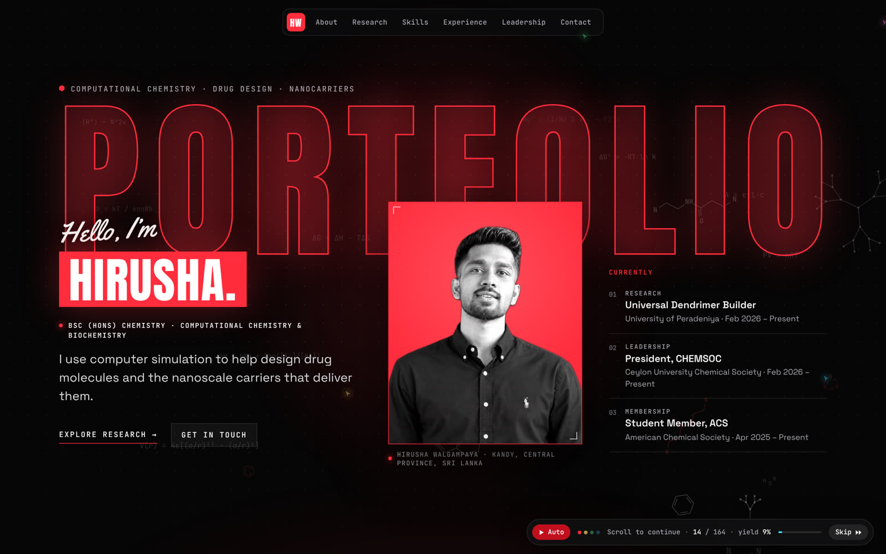
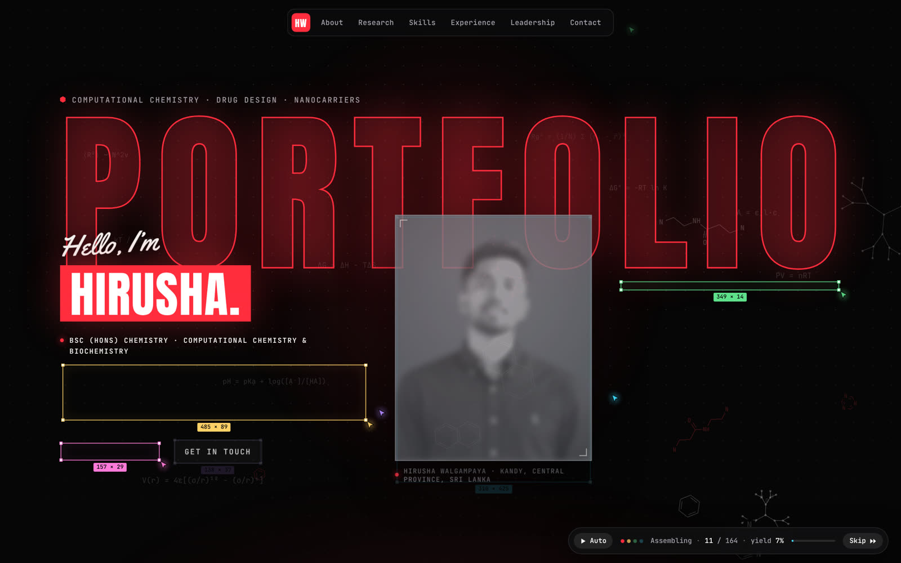
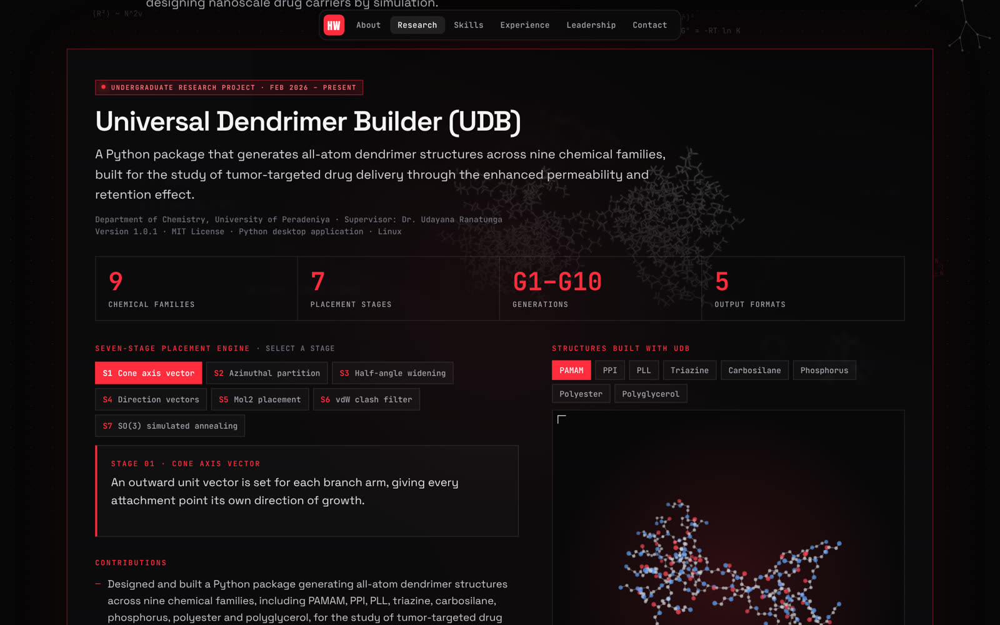
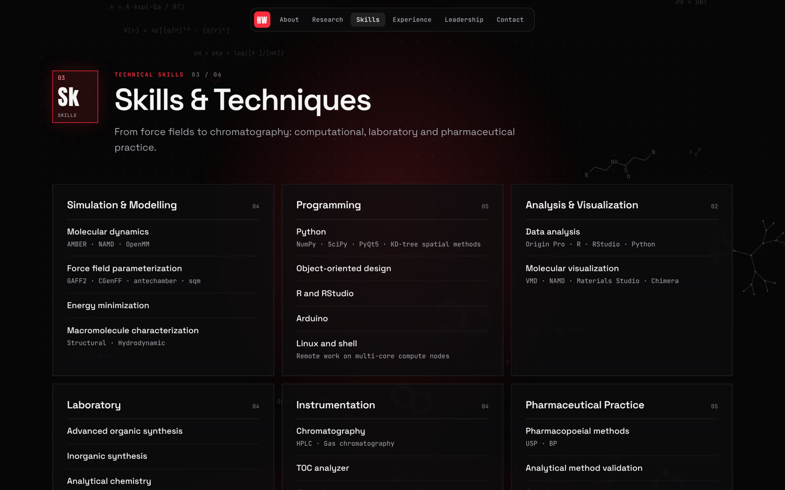

# Hirusha Walgampaya · Portfolio

Personal portfolio of Hirusha Walgampaya, BSc (Hons) Chemistry undergraduate at the
University of Peradeniya, working in computational chemistry, drug design and nanoscale drug
carriers.

**Live site: <https://hirusha-walgampaya.vercel.app>**



## What makes it different

- **The page assembles itself.** Small cursors of different colours fly in, draw a wireframe
  box for each element, fill it with a placeholder and reveal the real content, section by
  section. A pill at the bottom shows the progress as a "yield" and has a Skip button.
- **It scrolls itself.** Once the first screen has assembled, the page glides down on its
  own. Any touch, scroll, key press or click hands control straight back.
- **Real molecules.** The research section has a 3D viewer of 32 energy-minimised dendrimer
  structures built with the Universal Dendrimer Builder: eight chemical families, generations
  G1 to G4.
- **Chemistry in the background.** Skeletal molecules and equations (Beer–Lambert, Arrhenius,
  Lennard-Jones) drift faintly behind the content.
- **One database.** Every word and image on the site comes from a single file, so the
  portfolio is updated by editing data, not page code.

| Mid-assembly | Research | Skills |
|---|---|---|
|  |  |  |

## Sections

| Section | Contents |
|---|---|
| About | Profile, focus areas, education |
| Research | Universal Dendrimer Builder (seven-stage placement engine, 3D structure viewer), PolyBuilder, the Dendrimer Characterization Tool, SimQ, the Molecular File Format Converter, and a colorimeter built on an Arduino |
| Skills | Six categories: simulation and modelling, programming, analysis and visualization, laboratory, instrumentation, pharmaceutical practice |
| Experience | Pharmaceutical industry training in Sri Lanka and China |
| Leadership | Roles in the Ceylon University Chemical Society and faculty committees, professional membership, referees |
| Contact | Email, GitHub, LinkedIn |

Only the portrait is shown in the normal view. Each card that has photographs, screenshots or
diagrams has a **View images** button that expands them in place, uncropped; selecting one
opens it full size with its description.

## Built with

[Vite](https://vite.dev), [React](https://react.dev) and TypeScript. The animation, the
backdrop and the 3D viewer are written for this site on the browser's own canvas and DOM,
with no animation or 3D library. Fonts are self-hosted through
[Fontsource](https://fontsource.org). The result is a static site with no backend.

## The database

Everything the site says and shows is stored in
[`database/portfolio.json`](database/portfolio.json). The pages read from it, so changing the
site means changing that file.

| Table | What it holds |
|---|---|
| `person` | Name, role, location, email, links, portrait |
| `hero` | Headline word, tagline, the "Currently" list |
| `about` | Profile paragraphs, focus areas, education |
| `udb` | Universal Dendrimer Builder: description, seven stages, contributions, capabilities, families, links, 3D viewer settings |
| `polybuilder`, `software`, `colorimeter` | The other projects |
| `skills` | Six categories, each with its skills |
| `experience` | Internships: role, organisation, dates, bullet points |
| `leadership`, `membership`, `referees` | Roles, membership, referees |
| `quote` | The quotation in the contact section |
| `photos` | Every photograph and figure, grouped by the card it belongs to |
| `backgrounds` | The faint image behind each project and internship card |
| `sections` | The six sections and their tile symbols |

### Adding to it

- **A leadership role:** add `{ "role": "...", "org": "...", "place": "...", "when": "..." }`
  to `leadership`.
- **A skill:** add `{ "title": "...", "items": ["...", "..."] }` to the right category in
  `skills` (`items` is optional).
- **An image:** put it in `public/photos/` as `name.jpg`, with a copy about 720 px wide as
  `name-t.jpg`, then add an entry to the right list in `photos`:

  ```json
  {
    "src": "./photos/name.jpg",
    "thumb": "./photos/name-t.jpg",
    "alt": "What the image shows, for people who cannot see it",
    "details": "The sentence or two shown when the image is opened."
  }
  ```

### The check

`npm run check` reads the database and stops with a list of problems if an image file is
missing, a cross-reference does not resolve, a required text is empty, or a link or email
address is malformed. It also runs at the start of every build, so a slip in the data cannot
reach the live site.

## Run it locally

```bash
npm install
npm run dev      # development server at http://localhost:5173
npm run check    # validate the database
npm run build    # check, type-check and build into dist/
npm run preview  # serve the built site
```

## Project layout

| Path | What it is |
|---|---|
| `database/portfolio.json` | The database: every word and image reference |
| `public/portrait.webp` | The hero portrait, a cut-out with a transparent background |
| `public/photos/` | Photographs, screenshots and diagrams, each with a `-t` thumbnail |
| `public/bg/` | The faint card backgrounds |
| `public/structures/` | The 32 dendrimer structures shown in the 3D viewer |
| `src/content.ts` | Gives the database its types |
| `src/sections/` | One file per section of the page |
| `src/build/engine.ts` | The self-assembling animation and the automatic scroll |
| `src/components/Background.tsx` | The animated backdrop of molecules and equations |
| `src/components/Molecule.tsx` | The 3D structure viewer |
| `src/components/Gallery.tsx` | The "View images" button and the expanded images |
| `src/components/Lightbox.tsx` | The full-size view with a description |
| `src/styles.css` | All styling; colours are variables at the top |
| `scripts/check-database.mjs` | The database check |
| `scripts/mol2json.py` | Converts a MOL2 structure for the 3D viewer |

### The 3D structures

The structures come from `examples/Structures.tar.gz` in the
[Universal Dendrimer Builder](https://github.com/HirushaW/universal-dendrimer-builder)
repository. Each MOL2 file is converted to a small JSON file:

```bash
python3 scripts/mol2json.py dendrimer_pamam_gen2_min_gaff.mol2 public/structures/pamam_g2.json
```

The script keeps the heavy atoms and their bonds and reports the heavy-atom radius of
gyration. For PAMAM G2 it gives 13.922 Å, the same value the UDB Characteriser reports.

## Deployment

The site is hosted on [Vercel](https://vercel.com), linked to this repository. Every push to
`main` is built and published automatically (build command `npm run build`, output `dist`).

## Accessibility and privacy

- Visitors who prefer reduced motion get the finished page straight away, with no assembly
  animation and no automatic scroll.
- Every image has a text description, and the image viewer works from the keyboard.
- Location data was removed from the photographs before they were published.
- The phone number is deliberately left off the site.

## Credits

- Screenshots and diagrams of the software come from the
  [SimQ](https://github.com/HirushaW/Simulation-Queue),
  [UDB Characterization Tools](https://github.com/HirushaW/UDB-Characterization) and
  [Universal Dendrimer Builder](https://github.com/HirushaW/universal-dendrimer-builder)
  projects.
- The quotation in the contact section is from *The Feynman Lectures on Physics*.
- Typefaces: Anton, Yellowtail, Space Grotesk and JetBrains Mono.

© 2026 Hirusha Walgampaya. All rights reserved.
